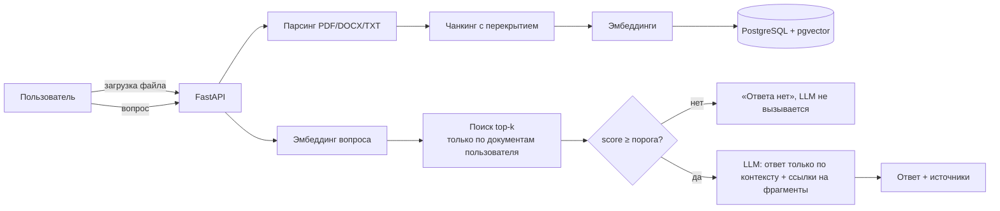

# AI Knowledge Assistant

Веб-приложение для вопросов по собственным документам (PDF, DOCX, TXT). Ответ строится только на найденных
фрагментах и сопровождается источниками: документ, страница, цитата. Если подтверждения нет — система честно
говорит, что не нашла ответа.

## Как это работает



Ключевые решения:

- **Отказ в два уровня.** Если ни один фрагмент не прошёл порог близости — LLM даже не вызывается. Если вызвана, но
  в контексте нет ответа — она отвечает маркером `NO_ANSWER`.
- **Источники — только процитированные.** Модель ставит `[1]`, `[2]` у утверждений; в ответ попадают те фрагменты,
  на которые она реально сослалась.
- **Изоляция пользователей.** Каждый запрос поиска фильтруется по `user_id`; чужой документ или чат возвращает 404.
- **Защита от prompt injection** в документах: контекст помечен как данные, инструкции внутри него игнорируются.
- **Провайдер LLM заменяем** — используется OpenAI-совместимый API, достаточно сменить три переменные в `.env`.

## Бесплатный API

Платить не нужно. Эмбеддинги считаются **локально** (модель `paraphrase-multilingual-MiniLM-L12-v2`, русский
поддерживается, ключ не нужен). Для генерации ответов нужен LLM-провайдер с бесплатным тарифом:

| Провайдер | Где взять ключ | `LLM_BASE_URL` |
|---|---|---|
| Google Gemini (по умолчанию) | https://aistudio.google.com/apikey | `https://generativelanguage.googleapis.com/v1beta/openai/` |
| Groq | https://console.groq.com/keys | `https://api.groq.com/openai/v1` |
| Ollama (локально, без ключа) | https://ollama.com | `http://localhost:11434/v1` |

Бесплатные тарифы имеют лимиты запросов и меняются — актуальные названия моделей смотрите у провайдера и при
необходимости правьте `LLM_MODEL`. При превышении лимита приложение вернёт понятное сообщение (HTTP 502).

### Режим заглушки

`LLM_PROVIDER=stub` в `.env` отключает обращения к модели: ответом служит первое предложение найденного фрагмента
со ссылкой на источник. Полезно для работы над интерфейсом и демо без расхода лимитов. Чтобы вернуться к настоящей
модели, поставьте `LLM_PROVIDER=openai` и перезапустите backend:
`docker compose up -d --force-recreate backend`.

## Запуск

```bash
cp .env.example .env        # впишите LLM_API_KEY и JWT_SECRET
docker compose up --build   # приложение: http://localhost:8080, API-документация: http://localhost:8000/docs
```

## Разработка без Docker

```bash
cd backend
python -m venv .venv && .venv/Scripts/activate     # Linux/macOS: source .venv/bin/activate
pip install -r requirements-dev.txt
python -m pytest                 # тесты (SQLite, без ключей и сети)
python -m eval.run --no-llm      # оценка поиска на тестовых вопросах (без ключа)
python -m eval.run               # полная оценка с LLM
python -m scripts.dev_server     # API на :8000 без Docker и без ключа (SQLite + заглушка вместо LLM)
```

Frontend (в другом терминале):

```bash
cd frontend
npm install
npm run dev                      # http://localhost:5173, запросы /api проксируются на :8000
```

> На Windows создавайте venv по короткому пути (например, `C:\kb-venv`) — при длинных путях часть библиотек не
> загружается.

## Оценка качества

`backend/eval/` содержит 3 документа-регламента и 18 вопросов (13 с ответом, 5 без). Результаты последнего запуска
поиска — в [`backend/eval/results_retrieval.md`](backend/eval/results_retrieval.md): нужный документ найден в
13/13 случаев, отказ на вопросах без ответа — 5/5. Набор небольшой, поэтому порог `MIN_SCORE` стоит перепроверять
на ваших реальных документах.

## API

`POST /api/auth/register`, `POST /api/auth/login`, `GET/PUT /api/auth/me|settings` ·
`GET/POST/DELETE /api/documents` · `GET/POST/DELETE /api/chats`, `POST /api/chats/{id}/ask`,
`GET /api/chats/{id}/messages`. Интерактивная документация — `/docs`.

## Статус

- [x] Backend: загрузка, индексация, RAG, источники, отказы, пользователи, история, настройки
- [x] Тесты (29) и оценка поиска
- [x] Frontend (React + TypeScript): вход, документы с загрузкой и статусами, чат с раскрываемыми источниками, настройки
- [x] Проверено на PostgreSQL + pgvector через `docker compose`: миграция, HNSW-индекс, SQL-поиск (результаты совпадают с эталонным Python-поиском), изоляция пользователей
- [x] Живой вызов Gemini проверен: ключ работает, на вопросах про «три дня» модель отвечает верно со ссылками на источники
- [ ] Полная оценка с LLM на 18 вопросах: прогон прерывался из-за лимитов бесплатного тарифа, повторить после сброса квоты (python -m eval.run --delay 8)
- [ ] Демо-видео, публичная демоверсия
